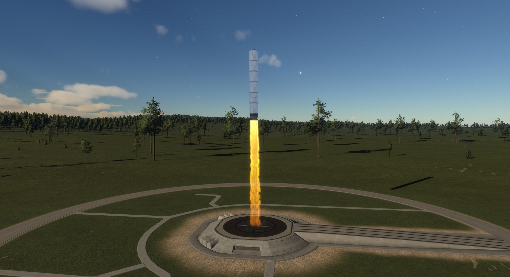

# Extended Propellants [](LICENSE)

A data-only mod for [Kitten Space Agency](https://ahwoo.com/app/100000/kitten-space-agency). It adds liquid propane, the reaction liquid oxygen plus propane and a yellow and orange exhaust plume. It has no parts and no code; other mods use it for their engines, for example [Prisma by Purrline Rocketworks](https://github.com/Maximilian-Nesslauer/KSA-PurrlinePrisma).

Validated against KSA build version 2026.11.10.5801.

[](https://youtu.be/jkoOCArH9X4)

*The launch video, made in the game with these mods.*



## What it adds

| Id | Kind | Notes |
| --- | --- | --- |
| `ExtProp_C3H8` | Substance | Propane, liquid and gas (`Phase="Liquid"` or `"Gas"`). Stored at 230.04 K, density 582.0 kg/m3. |
| `ExtProp_Propalox` | MixtureReaction | Liquid propane plus liquid `O2`, 16 mixture ratios by 14 pressures (20 kPa to 120 MPa), default mixture ratio 2.7. Shows in the engine designer as a bipropellant. |
| `ExtProp_PropaloxPlume` | VolumetricExhaustTemplate | The stock `EngineAMed` plume in yellow and orange. |

The tables are computed with CoolProp and NASA CEA with the method of the stock files. The `ExtProp_` prefix keeps the Ids apart from other mods and from a later stock propane.

## Use in an engine

In the `SubPart` Patch row of the engine subpart:

```xml
<SubPart Id="MyEngine_Subpart_Engine" Modify="Patch">
  <RocketCores Modify="Extend">
    <Combustor Key="ThrustChamber">
      <FeedsFroms>
        <FeedsFrom FromParent="true" />
      </FeedsFroms>
      <Reaction Ref="ExtProp_Propalox">
        <MixtureRatio>2.7</MixtureRatio>
      </Reaction>
      <MaxPressure Bar="149" />
      ...
    </Combustor>
  </RocketCores>
  <RocketNozzles Modify="Extend">
    <DeLavalNozzle Key="Nozzle">
      ...
      <ReactionPlumes>
        <ReactionPlume>
          <Reaction Ref="ExtProp_Propalox" />
          <VolumetricExhaust Ref="ExtProp_PropaloxPlume" />
        </ReactionPlume>
        <ReactionPlume Default="true">
          <VolumetricExhaust Ref="EngineAMed" />
        </ReactionPlume>
      </ReactionPlumes>
    </DeLavalNozzle>
  </RocketNozzles>
</SubPart>
```

- Give the engine its own `MixtureRatio`; the default of the reaction only sets the start value in the engine designer.
- The tanks fill themselves from the reaction of the engine they feed, so no tank XML changes.
- A data-only mod cannot declare a dependency in its `mod.toml`. List Extended Propellants as a `required` dependency in your listing in the Borea content index, and tell players to enable both mods. Without it the game logs a content error for your engine, and the parts that use it do not load.
- Load order does not matter.

## Install

- Borea: install it from the content list, or let Borea add it for a mod that needs it.
- By hand: copy `ExtendedPropellants` from the release zip into `Documents/My Games/Kitten Space Agency/mods/` and enable it.

## Licence

MIT ([LICENSE](LICENSE)).

## Links

[Forum thread](https://forums.ahwoo.com/threads/extended-propellants.ID/) | [Issues](https://github.com/Maximilian-Nesslauer/KSA-ExtendedPropellants/issues)
